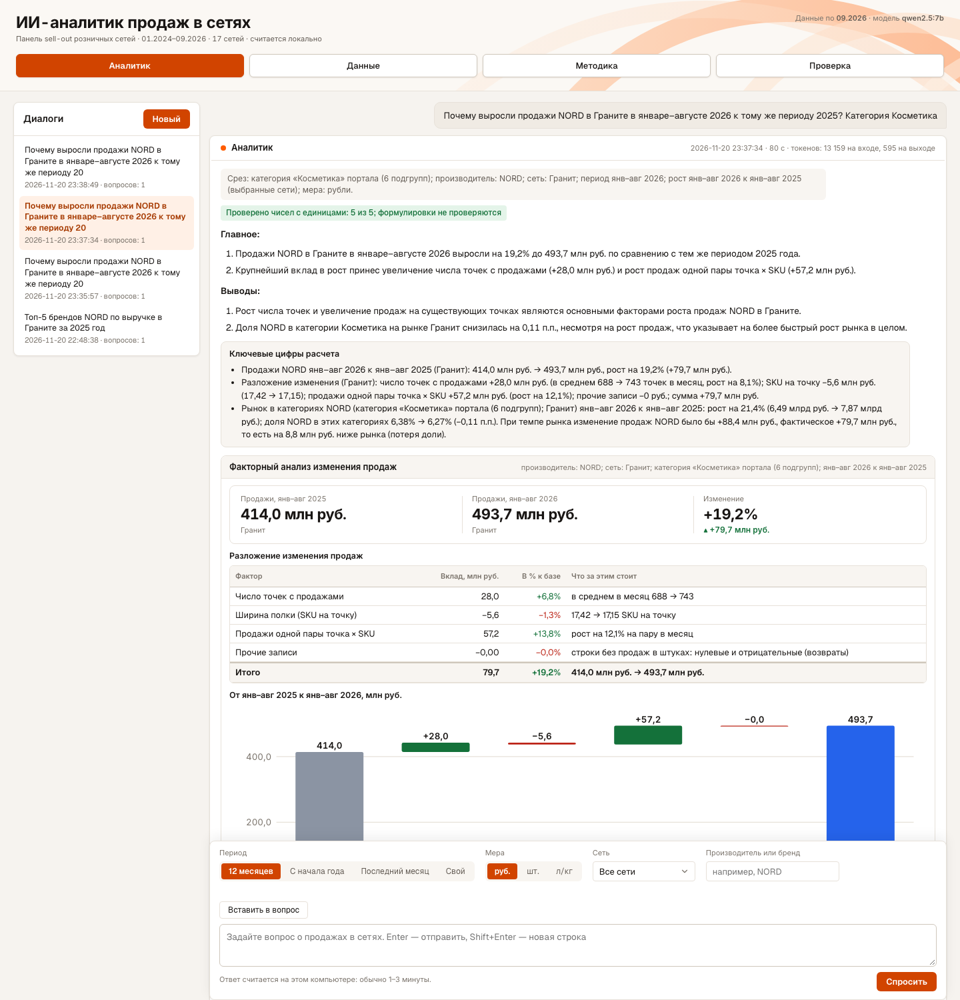
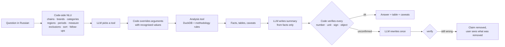
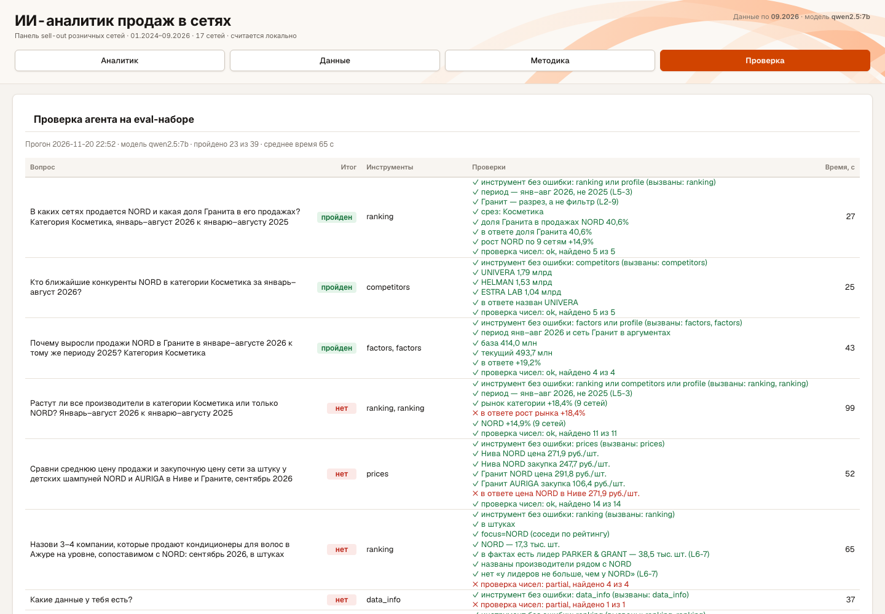

# Retail Sales AI Analyst

[](https://github.com/MaxWell-com/retail-sales-ai-analyst/actions/workflows/ci.yml)


**An LLM agent that answers business questions about retail sales in plain Russian.** Every number in its answer is checked by code. It runs fully locally on a laptop.

> A category manager types *«Почему упали продажи бренда X в сети Y за полгода?»*
> (*"Why did brand X sales drop in chain Y over the last six months?"*).
> The agent works out what is being asked, runs the right analysis over ~24M rows of store-level sell-out data,
> and writes a short answer with conclusions, a table and caveats. It never invents a number.

This is a production project, adapted for public release. It ran for the analytics team of a consumer-goods manufacturer on a licensed retail panel (store × SKU × month across Russian retail chains). That data is replaced here by a [synthetic panel](scripts/make_synthetic.py) with the same schema, the same entity structure and the same data defects. All chains, manufacturers and brands are fictional. The code, methodology, tests and eval set are the real ones.

<p align="center"></p>

<sub>*"Why did NORD sales grow in chain Гранит in Jan–Aug 2026 vs 2025?"* The code-written slice line comes first, then a badge saying 5 of 5 numbers are verified. Next: the summary and conclusions (growth came from more stores and higher sales per store × SKU, while the market grew faster, so the share slipped 0.11 pp), the key facts, and an LMDI factor decomposition with a waterfall chart.</sub>

## The core idea: code owns the numbers, the model owns the narrative

LLMs are good at choosing an analysis and explaining a result. They are bad at arithmetic, unreliable with entity names and they hallucinate numbers. So the work is split:



* **The model never sees raw rows and never writes SQL for typical questions.** It receives short, pre-computed facts, with totals before ranking lines. Only aggregates reach the model.
* **Code is authoritative where it is certain.** Recognised filters, the period, the measure and the sort order override whatever arguments the model passed. If the model writes *"Granite"*, the filter is still the chain *Гранит*.
* **Every number in the answer is verified** against the tool's facts by value, unit, sign and the object it refers to. Unsupported judgements ("the only", "all", "biggest") are flagged too. Anything unconfirmed is rewritten once. If it is still wrong, it is deleted and the user can see what was removed.
* **The methodology lives in code, not in the prompt.** Incomplete months are excluded from year-on-year comparisons on *both* sides. Stores registered under several IDs are de-duplicated. Markup is compared only within one chain and one year. Private labels, unknown manufacturers and chains with partial coverage are handled explicitly. See [docs/methodology.md](docs/methodology.md).

## What it can do

| Tool | Answers questions like |
|---|---|
| `ranking` | top brands / manufacturers / SKUs / chains / regions, shares, share change, neighbours around a focus object |
| `trend` | dynamics by month, year-on-year, seasonality |
| `profile` | overview of a manufacturer or brand: categories, chains, regions, growth drivers |
| `factors` | **why sales changed**: LMDI decomposition into stores × assortment depth × sales per store, by chain and by SKU |
| `distribution` | numeric distribution, share of stores, white-spot potential |
| `prices` | shelf price, chain purchase price, markup, price per litre, price index |
| `abc` | ABC analysis with class migration |
| `assortment` | assortment rotation: delisted and newly introduced SKUs |
| `forecast` | short-term forecast with explicit refusals when a series is unreliable |
| `competitors` | nearest competitors by segment, reproducing a commercial reference portal's rules |
| `data_info`, `find_entities`, `sql` | what data exists, fuzzy entity search, read-only SQL as a last resort |

Answers come with a "Срез" (slice) line written by code, so the user always knows *exactly* what was counted. They also include clickable next-step buttons, which run without the LLM, and export to Excel or PowerPoint.

## Quality: tested without the model, evaluated with it

| Layer | What is checked | Result |
|---|---|---|
| **362 unit tests** (no LLM, ~3 s) | question parsing for hundreds of Russian phrasings (declensions, abbreviations, look-alike words); every tool against **independent SQL**; refusals; the methodology rules | all green in CI |
| **Eval set, 39 questions** (through the LLM) | reference answers from a commercial analytics portal, real business-user questions, multi-turn dialogs, NLU regressions. 188 strict checks: right tool, right arguments, every number with unit and sign, forbidden claims | see below |

**Eval results on a laptop model (`qwen2.5:7b`, Apple M3, 39 questions, 186 checks):**

| Layer | Checks passed |
|---|---|
| Tool choice and arguments | **97%** (75 / 77) |
| Computed facts (tool output) | **100%** (57 / 57) |
| Answer text (key numbers present, no forbidden claims) | **77%** (40 / 52) |
| **All checks** | **92%** (172 / 186) |

23 of 39 questions pass *every* check, and 32 of 39 answers come out with every number confirmed. The pattern is the point of the design: the code-owned layers are exact. What a small model sometimes gets wrong is the narrative, for example leaving a key figure out of the summary. That is the part a larger model improves (see [Model and hardware](#model-and-hardware)).

**Known limitation.** The verifier checks figures, not the *direction* of a comparison. On a 7B model, a conclusion occasionally reads a "below the market" fact as "above". The next planned verifier rule is to check that comparison words (выше/ниже, рост/снижение) agree with the sign of the fact they cite.

<p align="center"></p>

The parsing tests are the agent's real moat. In Russian, *«в Ниве»*, *«Нивы»* and *«нива»* are the same chain. *«Ладно, а в штуках?»* is "OK, and in units?", not the chain ЛАД. *«семёрка лидеров»* means "top-7", not the chain Семёрочка. A brand spelled in Cyrillic must match its Latin label. A table of such cases guards every change.

## Model and hardware

The analyst is **model-agnostic**: any Ollama model with tool calling plugs in through a single setting, `VT_MODEL`. The defaults favour accessibility: `qwen2.5:7b` runs on an ordinary 16 GB laptop with no GPU.

**A larger model gives better answers.** The code already guarantees that every number is correct: it parses the question, runs the calculation and checks every figure in the reply. What the model still decides is *which analysis to run* and *how well the conclusions read*, and both improve noticeably with model size. On a 30B-class model the agent picks the right tool more often, keeps multi-turn context better and writes tighter, more insightful summaries.

**A GPU makes it fast.** The calculations themselves take 0.3–2 s in DuckDB. Almost all of the response time is spent in the model. On a CPU-only machine a reply takes one to two minutes. On a single 24–48 GB GPU the same model runs roughly 5–10× faster, so answers arrive in seconds and the agent can serve several people at once.

| Setup | Model | Typical reply |
|---|---|---|
| Laptop, Apple M3, 16 GB | `qwen2.5:7b` | ~1 min (65 s mean over the eval set) |
| Workstation, CPU only | `qwen3:30b` | ~1.5–2 min, noticeably better answers |
| Single GPU, 24–48 GB | `qwen3:30b` and larger | seconds |

## Quickstart

```bash
git clone https://github.com/MaxWell-com/retail-sales-ai-analyst.git
cd retail-sales-ai-analyst
python -m venv .venv && source .venv/bin/activate
make setup          # dependencies
make data           # synthetic panel → data/retail.duckdb (~20 s, ~24M rows)
make test           # 362 tests, no LLM needed

ollama pull qwen2.5:7b
make run            # http://localhost:8765
```

Or with containers (app + Ollama + model pull):

```bash
docker compose up --build      # then open http://localhost:8765
```

Settings live in [`.env.example`](.env.example): the model, the Ollama URL, memory limits and the company the analyst works for (`VT_OWN_MANUFACTURER`, whose categories are the default scope).

## The synthetic panel

[`scripts/make_synthetic.py`](scripts/make_synthetic.py) generates 17 chains, ~1,600 stores across 30 regions, ~3,200 SKUs from fictional manufacturers and private labels, and 33 months of store-level sales. It deliberately reproduces the defects the methodology must survive:

- chains with partial coverage, gaps, or a chain that stopped reporting;
- an incomplete last month: one chain loaded only some of its stores, another only part of each store's sales;
- one physical store under several IDs;
- a banner that can only be inferred from a format code, plus a growing "other" bucket;
- stores without a city;
- a brand labelled `.`;
- a cash-and-carry chain with zero purchase cost.

The tests pin the agent's behaviour on each of these. Field-level documentation is in [docs/data_dictionary.md](docs/data_dictionary.md).

## Repository structure

```
app/
├── entities.py     # Russian NLU: entities, morphology, periods, exclusions, follow-ups (no LLM)
├── agent.py        # agent loop: tool choice, argument override, fact-only summary, number verification
├── semantic.py     # semantic layer: periods, filters, coverage checks, methodology rules → SQL
├── tools.py        # ranking, trend, profile, entity search, data info, read-only SQL
├── tools2.py       # factors (LMDI), distribution, prices, ABC, assortment, forecast, competitors
├── result.py       # facts / tables / caveats container shared by tools and the verifier
├── exports.py      # Excel / PowerPoint export
├── server.py       # FastAPI: async jobs, SSE progress, conversation history, /health
└── web/            # dependency-free chat UI (vanilla JS, embedded fonts)
scripts/            # synthetic data generator, DuckDB warehouse build
tests/              # 362 tests without the LLM
eval/               # 39-question eval set + strict runner
docs/               # architecture, methodology, data dictionary
```

**Stack:** Python · DuckDB · FastAPI · Ollama (Qwen) · pandas · vanilla JS · pytest · Docker · GitHub Actions

---

## Кратко на русском

**ИИ-аналитик продаж в розничных сетях.** Агент отвечает на вопросы на естественном русском языке по данным sell-out (точка × SKU × месяц). Модель работает локально, данные никуда не уходят. Это рабочий проект, адаптированный для публикации: реальные данные заменены синтетическими с той же структурой и теми же дефектами, все сети и бренды вымышленные.

* **Главный принцип:** числа считает и проверяет код, модель выбирает анализ и пишет выводы. Каждое число в ответе сверяется с расчётом по значению, единице, знаку и объекту. Неподтверждённое переписывается, а если ошибка остаётся — удаляется, и пользователь это видит.
* **Распознавание вопроса** сделано кодом, без модели: падежи, сокращения, похожие на названия слова, исключения, уточнения прошлого вопроса.
* **13 аналитических инструментов**, среди них факторный анализ (LMDI), представленность, цены и наценка, ABC, ротация ассортимента, прогноз и конкуренты.
* **Качество:** 362 теста без модели (инструменты сверяются с независимым SQL) и eval-набор из 39 вопросов со строгими проверками.
* **Модель и железо:** чем крупнее модель, тем точнее агент выбирает расчёт и тем лучше пишет выводы. С видеокартой ответы приходят в 5–10 раз быстрее — за секунды вместо минут.

## License

[MIT](LICENSE)
