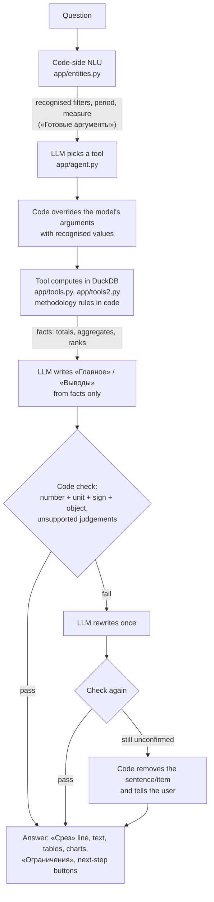

# Architecture: how the agent answers

The agent answers Russian natural-language questions about a retail sell-out panel. A local LLM (Ollama) never sees
raw rows and never does arithmetic: code parses the question, computes every number in DuckDB, and verifies every
number the model writes. The model's job is narrow — pick a tool and phrase the answer from facts.

## Pipeline

1. **Code-side NLU** (`app/entities.py`). Rule-based recognition of chains, banners, formats, manufacturers, brands,
   categories, geography, periods, measure, exclusions («кроме», «без» — "except", "without"), sort order ("by
   growth"), comparison object ("on the level of X") and follow-ups to the previous turn. A doubtful word is left
   unrecognised rather than turned into a wrong filter. The result is shown to the user as «Распознано» (Recognised).
2. **Tool choice.** The model receives the question plus the exact dictionary values ("ready-made arguments") and
   picks one of the tools. A tool call the model writes as plain text is detected and executed. At most 4 steps.
3. **Argument override.** Wherever code is confident, its values replace the model's: a local model garbles names
   («Гранит» → "Granite"), drops periods or invents filters.
4. **Calculation.** Tools build SQL through the semantic layer (`app/semantic.py`): period arithmetic, filters, the
   9 comparable chains for growth, incomplete chain-months excluded on both sides, stores counted by `store_key`,
   own-company categories as the default scope (see [`methodology.md`](methodology.md)). Each tool returns a `Result`
   (`app/result.py`): facts for the model, tables and charts for the UI, caveats, and next-step suggestions. The
   «Срез» (Scope) line under every answer is written by code.
5. **Answer.** The model writes **«Главное»** (2–3 key points) and **«Выводы»** (0–3 takeaways) using only the
   facts. Facts already contain totals, counts, rank windows and row aggregates, so the model has nothing to add up,
   sort or count.
6. **Verification** (`agent.check_answer`). Every number with a unit must exist in the facts at the precision shown;
   its sign must match; a number next to an object must belong to that object (or the totals). Judgements without
   support in the data ("premium", "dominates", "keeps leadership", …) and causal claims without the "hypothesis"
   label are flagged. The model gets one rewrite with the list of problems; anything still unconfirmed is removed by
   code, and the UI shows what was removed. If no tool succeeded, the agent says it could not compute the answer
   instead of letting the model produce numbers.

## Tools

| Tool | Purpose |
|---|---|
| `data_info` | What the data is: period, volume, chains, categories, measures |
| `find_entities` | Exact names of brands, manufacturers, SKUs |
| `ranking` | Top-N and shares; sort by sales, growth, gain, decline, share change; neighbours of an object in the ranking |
| `trend` | Monthly dynamics, shares of top-N over time, seasonality |
| `profile` | Manufacturer or brand overview: growth, share in its categories, adult/kids, brands, chains |
| `factors` | Factor analysis of a sales change: partial chains, stores × SKUs per store × sales per store-SKU (LMDI, no residual), market pace, contributions of brands, subgroups, SKUs, districts |
| `distribution` | Numeric distribution: share of stores with the category that sell the object; potential |
| `prices` | Retail price, chain purchase price, markup (within one chain), price per litre, Laspeyres price index on identical SKUs |
| `abc` | ABC analysis of SKUs or brands (80% / 95%), adult and kids separately |
| `assortment` | Rotation in a chain: delisting and introduction candidates |
| `forecast` | 1–6 month forecast: seasonal and annual-trend methods, their mean, a range from the backtest error; refused if the backtest error or the gap between methods exceeds 30% |
| `competitors` | Competitors in the target's segments (subgroup × product, 0.5×–2× of the target) |
| `sql` | Last resort: one read-only `SELECT`/`WITH`, 200 rows, 60 s timeout |

## Conversation memory and next steps

- **History stores code output, not model text**: each past turn is kept as its «Срез» line plus up to four key
  figures computed by code. The model's prose never re-enters the context, so an error cannot propagate.
- **Follow-ups** ("and in units?", "which SKUs exactly…") inherit the period, filters and measure they lack from the
  previous turn's slice; «Распознано» shows what was inherited. A new question without follow-up cues inherits nothing.
- **Next-step buttons** («Что посмотреть дальше») are built by tools from what they can actually compute. A button
  runs its tool with fixed arguments, bypassing the model's tool choice (faster and exact); buttons never offer `sql`.

## Data coverage checks

`semantic.coverage()` checks load completeness for every chain × month (stores by `store_key` and revenue against
the median of the previous three months). Incomplete months are excluded from year-over-year comparisons on both
sides, caveated in shares, skipped as the default month for distribution, and left out of forecast series. Store counts
always use `store_key` (chain + store code), because one physical store can appear under several `store_id`s. See
methodology §3.7 and §5.4, and the defects table in [`data_dictionary.md`](data_dictionary.md).

## Testing

- **Without the LLM, in seconds**: `make test` (`pytest`). Question parsing is tested against a table of
  phrasings; every tool is tested against independent SQL written in the tests (e.g. stores re-derived from
  `store_code` without the `store_x` table, incomplete months re-excluded by hand).
- **Through the LLM**: `make eval` (`python -m eval.run_eval`) runs `eval/questions.json` — single questions and
  multi-turn dialogues — and checks answers strictly: expected tool calls and arguments, exact numbers in facts and
  text (tolerance = half of the last displayed digit), forbidden phrasings, the «Срез» line and the verification
  status. `--rescore` re-checks the last saved run without the model. Results appear on the «Проверка» page of the UI
  and in `eval/results/latest.json`. Every fixed agent error becomes a rule in code or methodology plus a new eval
  question.

## Running and deployment

- Local: `make setup && make data && make run`, then open http://localhost:8765 (needs Ollama with `$VT_MODEL`
  pulled). `make docker` starts the app and Ollama in containers with the synthetic warehouse baked into the image.
- **Deployment contract** (`app/server.py`):
  - port from `PORT` (default 8765);
  - unauthenticated `GET /health` → `{"ok": true}`;
  - user identity from the `X-Auth-Request-Email` / `X-Auth-Request-User` headers set by an authenticating reverse
    proxy (e.g. oauth2-proxy); without them the user is `local`.
- Answers stream to the UI over SSE (`/api/ask/{id}/events`) and can be exported to Excel and PowerPoint.
- Configuration: `OLLAMA_URL`, `VT_MODEL`, `VT_NUM_CTX` (model); `VT_DB`, `VT_THREADS`, `VT_MEMORY` (DuckDB);
  `VT_OWN_MANUFACTURER`, `VT_OWN_MIN_SHARE` (own company and its default categories); `VT_STORE` (conversation
  history and saved answers).
